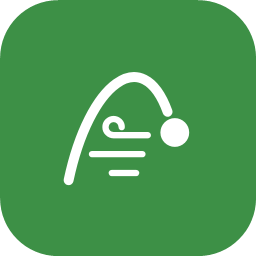
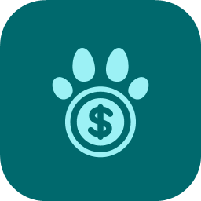

### Hi, I'm Johan 👋

**.NET developer** — by day I build Android apps with .NET Android and web apps with ASP.NET Core & Blazor. On the side I ship my own apps and games for iOS & Android under [Nilbyte Studio](https://nilbytestudio.com), built with .NET MAUI and Unity.

#### 📱 Apps on the stores

<table>
  <tr>
    <td width="96" align="center"></td>
    <td>
      <b>Jingle Drop</b> — a cozy Christmas arcade game. Steer Santa's sleigh over a snowy village and drop gifts down glowing chimneys.  
      
      
    </td>
  </tr>
  <tr>
    <td width="96" align="center"></td>
    <td>
      <b>ForeWind</b> — a golf shot calculator that adjusts shot distances using live weather, GPS, and compass data.  
      
      
    </td>
  </tr>
  <tr>
    <td width="96" align="center"></td>
    <td>
      <b>RefundHound</b> — a refund tracker that keeps tabs on returns and refunds so nothing slips through the cracks.  
      
      
    </td>
  </tr>
</table>

#### 🧰 Stack

**At work** 

**Side projects** 

#### ⛳ Off the clock

When I'm not coding you'll find me on the golf course — or perfecting my Neapolitan pizza 🍕

#### 📫 Elsewhere

[nilbytestudio.com](https://nilbytestudio.com) · [j.nilsson89@outlook.com](mailto:j.nilsson89@outlook.com)
